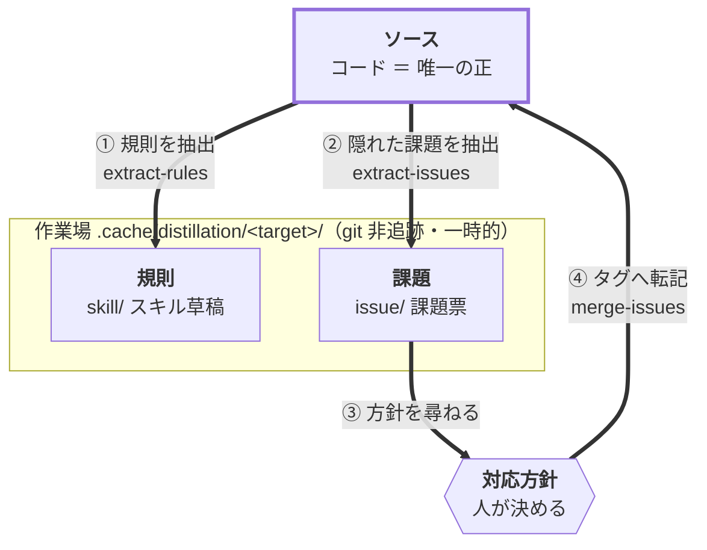

# distillation

コードを一次情報（＝正）として読み、そこから規則・慣習を **蒸留** して再利用可能なスキル草稿にまとめる
Claude Code プラグイン。あわせて未起票の**課題**を抽出して起票し、ユーザーの対応方針を
**ソースの `TODO:` / `FIXME:` / `REJECT:` タグへ還す**（コードファースト＝正をコードに一本化する）。

インストール手順・marketplace の仕組みは [リポジトリ README](../../README.md) を参照。

```shell
/plugin marketplace add sasano8/skills
/plugin install distillation@sasano8-skills
```

自然文でも起動する（「規則を抽出して」「課題を洗い出して」「課題をマージして」など）。

## コンセプト

扱うのは **ソース・規則・課題**の 3 成果物だけ。



- **ソース** — 唯一の正。規則も課題もここから出て、課題は必ずここへ還る。
- **規則** — ソースから読み取った**派生物**。正にしない（provenance と確度を付け、再実行時に
  ソースから再生成する）。他プロジェクトへ持ち出せる形にまとめるのが成果。
- **課題** — 方針が決まるまでの**一時的な作業場**。決まったらタグとしてソースへ還し、課題票からは
  節ごと消す。採用も却下も保留もソースに残るので、同じ課題が二度上がらない。

④ が要点で、これがあるから**正が二重化しない**。課題票は消えてもソースのタグが残り、次回の抽出は
そのタグを見て重複を避ける。マージが書くのはタグだけで、実修正はしない（タグを起点に通常の開発で直す）。

現状のタグと未処理の課題を見るだけなら `grep-issues`（read-only）。この輪の外側にあり、何も書かない。

## 4 つのスキル

| スキル | 動作 | 書き込み先 |
| --- | --- | --- |
| `/distillation:extract-rules` | scope 確定 → 読解 → スキル草稿の生成/更新（規則抽出） | `skill/` |
| `/distillation:extract-issues` | scope 確定 → 読解 → 未起票の課題を起票 → 対応方針を尋ねる（課題抽出） | `issue/` |
| `/distillation:merge-issues` | 対応方針をソースのタグへ**転記**（還流） | 対象ソース、`issue/` |
| `/distillation:grep-issues` | ソースの `TODO:｜FIXME:｜REJECT:` と open 課題票を一覧 | **書かない（read-only）** |

蒸留＝**抽出（extract）→ 濃縮 → 還流（merge）** のプロセス全体の名前で、各スキルはその工程にあたる。
転記は転記だけを行い、実修正はしない。

共通定義（原則・ディレクトリ体系・config と scope・課題票の書式・タグ文法・モード・設計の根拠）は
[`reference.md`](reference.md) が正本で、各 SKILL.md は自分の手順だけを持つ。
4 スキルはプラグインルートの実体を `skills/<name>/reference.md` の symlink で共有している
（この方式を選んだ理由と Windows 非対象の注記は
[リポジトリ README](../../README.md#スキル間で定義を共有するsymlink-方式)）。

成果物・課題・scope は対象プロジェクトの `.cache/distillation/<target>/` に target 単位で永続管理する
（git 非追跡の作業場。コミットしない）。

## CI で回すときの注意

`merge-issues` はユーザーの対応方針を入力に取るため、**人間のいない CI では走らせない**。
CI で回すのは `extract-rules` / `extract-issues`（起票まで）と `grep-issues`（read-only）に限り、
対応方針は PR のレビューコメントで返して、転記は手元の対話セッションで行う。

## 詳細

- 共通定義: [`reference.md`](reference.md)
- 各スキルの手順: [`extract-rules`](skills/extract-rules/SKILL.md) /
  [`extract-issues`](skills/extract-issues/SKILL.md) /
  [`merge-issues`](skills/merge-issues/SKILL.md) /
  [`grep-issues`](skills/grep-issues/SKILL.md)

設計判断の外部的な根拠（ETH Zurich の実証・タグ文法の先行例）は `reference.md` の「設計の根拠」節にある。
仕様を変えるときはそこを先に読む。