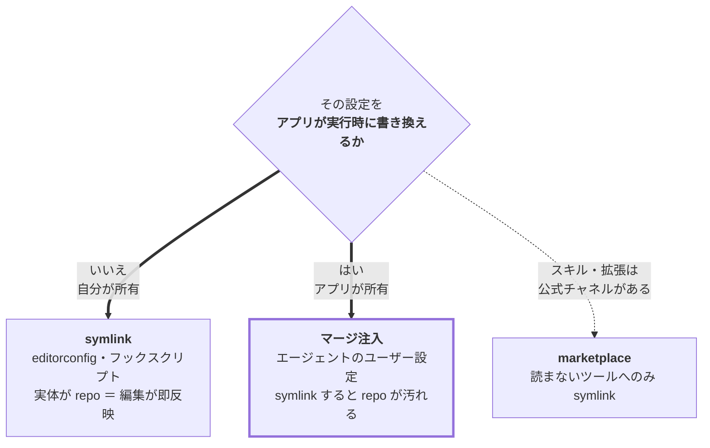

# onboarding

開発マシン／新環境を**冪等・非破壊に**セットアップする Claude Code プラグイン。
判断（何を・なぜ）は持たず、**導入手順だけ**を持つ。

インストール手順・marketplace の仕組みは [リポジトリ README](../../README.md) を参照。

```shell
/plugin marketplace add sasano8/skills
/plugin install onboarding@sasano8-skills
```

自然文でも起動する（「新しいマシンをセットアップ」「dotfiles を反映して」「gitleaks を入れたい」など）。

## 収録スキル

| スキル | 責務 |
| --- | --- |
| [`agent-install`](skills/agent-install/) | エージェント本体（Claude Code / Codex CLI）をマシンへ入れる。導入方式の選び分け（自動更新が効くか）と認証まで |
| [`env-bootstrap`](skills/env-bootstrap/) | 版管理された dotfiles をマシンへ反映する。配線の点検と、配布方式（symlink / マージ注入 / marketplace）の選び分け |
| [`secret-guard`](skills/secret-guard/) | シークレット混入を commit 前に止める（gitleaks + global pre-commit + secret baseline） |

原則・進め方・配布方式の正本は [`reference.md`](reference.md)。

## 配布方式の選び分け（このプラグインの核）

版管理した設定をマシンへ反映する方式は、**対象がどちらに所有されているか**で決まる。



**アプリが書き換えるファイルを symlink すると必ず壊れる** — アプリが状態を書くたびに repo が dirty になり、
マシン固有の絶対パスが多マシン共有のリポジトリへ流入する。Claude Code の `~/.claude/settings.json` は
公式が [Do not commit](https://code.claude.com/docs/en/settings) と明記しており、`/config`・`/model`・
プラグインのインストールでアプリ自身が書き込む。詳細と代替（マージ注入 / プロジェクト設定 / managed settings）は
[`reference.md`](reference.md)「配布方式の選び分け」。

## 関連

- 「シークレットを commit しない」という**規約の正本**は `quality` プラグインの **R15**。
  このプラグインはそれをマシンに materialize する手順だけを持つ。
