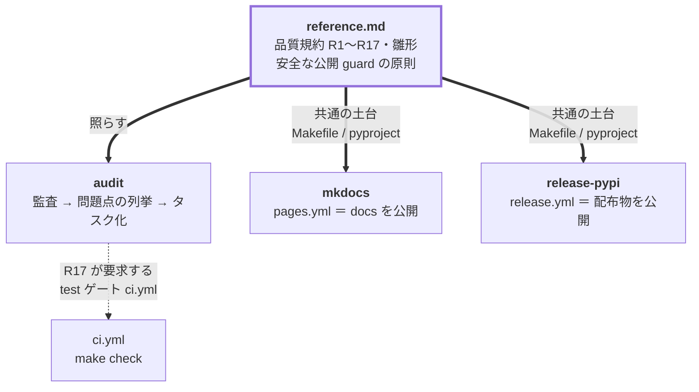

# quality

プロジェクトの**品質規約を正本として持ち**、対象リポジトリをそれに照らして監査し、是正をタスクとして
処理させる Claude Code プラグイン。あわせて **docs サイトと PyPI リリースの公開 CI** を、
**CI を割らない安全な guard** 付きで整える。

スキャフォルダではなく「あるべき姿との差分を埋める」運用。新規リポジトリは全項目が「不在」として挙がる
だけで同じ流れに乗る。**Python + uv 前提**（他言語は `reference.md` にルール表と雛形を足して拡張する）。

インストール手順・marketplace の仕組みは [リポジトリ README](../../README.md) を参照。

```shell
/plugin marketplace add sasano8/skills
/plugin install quality@sasano8-skills
```

自然文でも起動する（「品質チェックして」「足回りを整えて」「docs を公開したい」「PyPI に公開したい」など）。

## 収録スキル

| スキル | 責務 |
| --- | --- |
| [`audit`](skills/audit/) | 品質規約 R1〜R17 に照らして監査し、問題点を列挙してタスク化する（即応しない指摘は課題票へ先送り） |
| [`mkdocs`](skills/mkdocs/) | MkDocs（Material）の docs サイトと GitHub Pages 公開 CI を整える |
| [`release-pypi`](skills/release-pypi/) | 配布物を PyPI へ公開するリリース CI を整える（Trusted Publishing 既定） |

規約・雛形・共通原則の正本は [`reference.md`](reference.md)。各 SKILL.md は自分の関心の差分だけを持ち、
規約を再記載しない（コピペは drift 源）。

監査の指摘を今すぐ直すか迷うときは**課題として先送り**できる。受け皿は対象リポジトリの規約ファイル
（AGENTS.md / CLAUDE.md）の課題管理の宣言（`issue-tracking: <起票を担うスキル>`）で解決し、
指定されたスキルに従って起票する。宣言が無ければ保留の列挙に留める。仕組みの中身は指定された
スキル側の文書が正本（このプラグインは知らない）。
詳細は [`reference.md`](reference.md)「先送りする指摘の扱い」。

## 3 スキルの関係



**CI は 3 本に分かれ、関心が違う**:

| ワークフロー | 目的 | 発火条件 | 持ち主 |
| --- | --- | --- | --- |
| `ci.yml` | テスト（品質ゲート） | 全ブランチの push / PR | `reference.md`（R17） |
| `pages.yml` | docs の公開 | PR は検証のみ／main への push で公開 | `mkdocs` |
| `release.yml` | 配布物の公開 | `v*` タグの push のみ | `release-pypi` |

公開系（`pages.yml` / `release.yml`）が共有する核は **「PR で環境保護ルールに弾かれて CI が赤くなる事故を
構造で防ぐ」**こと。`if` に `github.event_name == 'push'` を必ず AND し、PR から到達する job に
`environment:` を置かない。詳細は [`reference.md`](reference.md)「安全な公開 guard」。